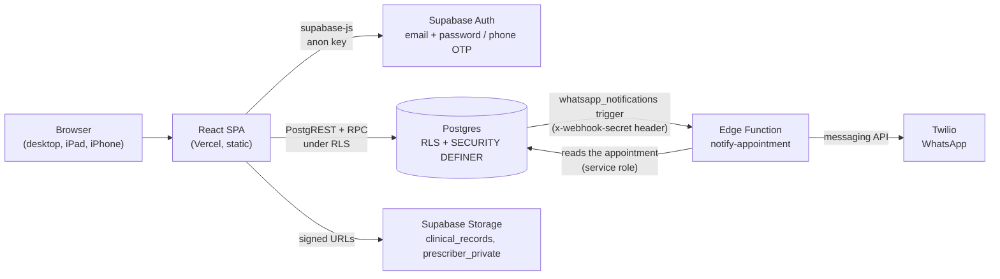
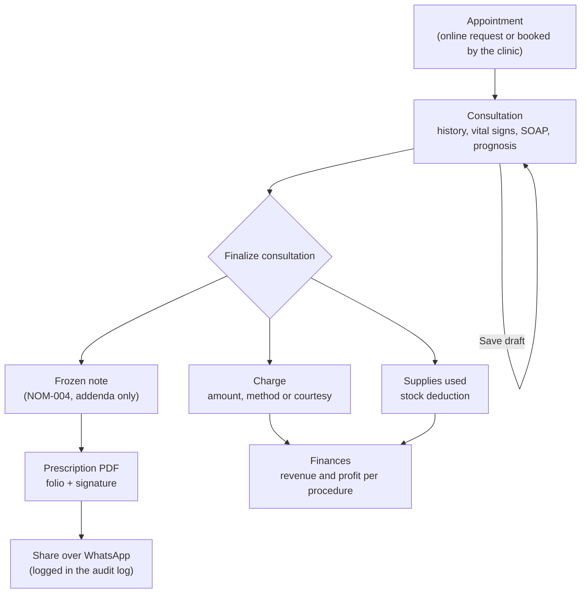
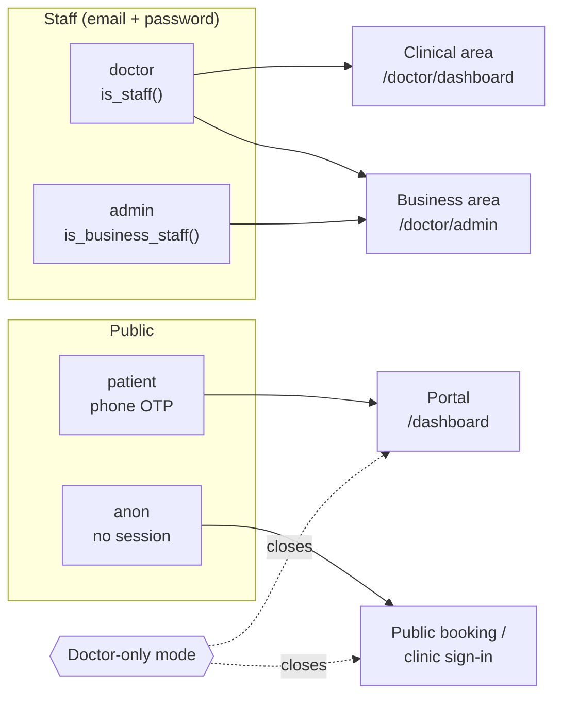

# Patient Management

A management system for the private practice of an aesthetic-medicine doctor in Monterrey, N. L. (Mexico): calendar, clinical record, digital prescription, inventory, finances and a patient portal. It is a React SPA that talks directly to Supabase. Security lives in the database (RLS and `SECURITY DEFINER` functions), not in the frontend.

> **Legal framework considered:** LFPDPPP 2025 (personal data), NOM-004-SSA3-2012 (clinical record) and NOM-024-SSA3-2012 (health information systems). The analysis is in [`docs/compliance.md`](docs/compliance.md). It is a technical gap analysis, **not a legal certification**: a lawyer's review is still pending (see [Known limitations](#known-limitations)).


## Quick start

```bash
npm install
# Create .env with VITE_SUPABASE_URL and VITE_SUPABASE_ANON_KEY (see "Setup")
npm run dev        # http://localhost:5173
npm test           # unit tests (Vitest)
```

The database is **not** run locally: migrations are applied by hand in the Supabase SQL Editor (see [Database and migrations](#database-and-migrations)).

## Contents

- [Features](#features)
- [Architecture](#architecture)
- [Roles and access](#roles-and-access)
- [Stack](#stack)
- [Project structure](#project-structure)
- [Setup and local development](#setup-and-local-development)
- [Database and migrations](#database-and-migrations)
- [Testing](#testing)
- [Deployment](#deployment)
- [Operations and security](#operations-and-security)
- [Known limitations](#known-limitations)
- [Documentation](#documentation)

## Features

The UI is in Spanish. Quoted names are the labels you will find in the app.

| Area | What it does |
| --- | --- |
| Calendar and scheduling | Daily/weekly appointments in Monterrey time, rescheduling, cancellation with a reason, blocked hours and dates ("Bloquear Horario" / "Bloquear Fechas"), no overlaps (enforced by a transactional lock in the database), and "Registrar cita pasada" (record past visit) to transcribe past appointments from the paper agenda with their charge dated to the visit. |
| Patient directory | Create and edit patients, one record per phone number, record a privacy notice signed on paper. |
| Consultation (NOM-004) | Medical history, present illness, vital signs, SOAP note, prognosis. Once finalized ("Finalizar Consulta") the note is frozen and only accepts addenda. |
| Digital prescription | PDF with prescriber data, professional license (cédula), drawn signature and folio number. Shared over WhatsApp from the device; every share is logged in the audit log. |
| Weight tracking (InBody) | Body-composition measurements per patient and their trend. |
| Inventory and supplies | Movement ledger (purchases, usage, adjustments), supplies per service, and automatic stock deduction when a consultation is finalized. |
| Finances ("Finanzas") | Charges per consultation, charts, profit per procedure (price minus supply cost). The admin account sees amounts without patient names. |
| Privacy | ARCO requests (access, rectification, cancellation, opposition) with due dates, patient data export, anonymization, and an audit log of writes ("Bitácora"). |
| Doctor-only mode ("Modo solo doctora") | Closes the patient portal and online booking; the home page becomes the clinic's sign-in. |
| Patient portal | Phone OTP sign-in, booking, rescheduling, history, files and ARCO rights. |
| Devices | Desktop, iPad (portrait and landscape) and iPhone, with reviewed touch targets. |

## Architecture



- **There is no custom backend.** Every sensitive business rule (booking, finalizing, charging, ARCO) is an RPC in Postgres.
- **Clinic time:** `America/Monterrey`, in tests too (Vitest and Playwright pin that time zone).
- **WhatsApp:** the decision of which message to send lives in `supabase/functions/notify-appointment/notificationDecision.ts` (a pure function, tested in `src/lib/notifications/`).

### Doctor's main flow



## Roles and access



In the app, the clinical area is "Centro Clínico" (its dashboard is titled "Centro de Comando") and the business area is "Administración".

| Role | Can | Cannot |
| --- | --- | --- |
| `doctor` | Everything clinical and business; turn doctor-only mode on and off. | — |
| `admin` | Catalog, inventory and finances (amounts and service). | See patients, notes, prescriptions, files or the audit log. |
| `patient` | See only their own data (`current_patient_id()`), book, reschedule, cancel, submit ARCO requests. | Write clinical tables or change their own role (a trigger blocks it). |
| `anon` | Read availability, opening hours and the clinic mode. | Read or write any table holding personal data. |

- The role lives in `profiles.role`; every new sign-up starts as `patient`.
- Sensitive writes go through `SECURITY DEFINER` RPCs with a pinned `search_path`; permissions are checked inside each function.
- In **doctor-only mode**, the portal RPCs refuse first and the portal shows no data.

## Stack

| Layer | Technology (version in `package.json`) |
| --- | --- |
| UI | React 19.2, React Router 7, Tailwind CSS 4.2, Framer Motion 12, lucide-react, react-hot-toast |
| Charts and PDF | Recharts 3, pdf-lib 1.17.1 |
| 3D decoration | three 0.183, @react-three/fiber 9, @react-three/drei 10 |
| Build | Vite 7, TypeScript 5.9, ESLint 9 |
| Backend | Supabase (Postgres, Auth, Storage, Deno Edge Functions) via `@supabase/supabase-js` 2 |
| Messaging | Twilio WhatsApp |
| Testing | Vitest 4 + Testing Library + jsdom, Playwright 1.64, k6 |
| Hosting | Vercel (static only) |

## Project structure

```text
src/
  App.tsx                 Routes and per-role guards
  features/
    appointments/         Booking, rescheduling, service and time-slot selection
    auth/                 Staff sign-in, patient OTP, registration, consent, useAuthRole
    clinicMode/           Doctor-only mode provider and hook
    doctor/               Clinical and business areas: tabs, modals, calendar,
                          consultation, prescription (prescription/), weight tracking
    patients/             Patient portal and its widgets
  lib/
    services/             Supabase access per domain (appointments, patients, SOAP, finance,
                          inventory, privacy, storage...), each with tests
    legal/                Privacy notice and ARCO labels
    files/                Clinical file upload rules
    clinicTime.ts         Monterrey time utilities
  components/
    ui/                   Base components (DataGrid, DatePicker, Dropdown, Modal...)
    layout/, legal/       Header, layout and legal texts
  test/                   Vitest setup (time zone, Supabase mock, viewport)
supabase/
  migrations/             30 numbered migrations + audit/ (read-only check)
  tests/                  Per-migration check scripts (begin ... rollback)
  maintenance/            Pre-production reset and demo data (NEVER run automatically)
  functions/notify-appointment/   WhatsApp Edge Function
e2e/                      Playwright (see e2e/README.md)
load/                     k6 (see load/README.md)
docs/                     Compliance, runbook, QA, deployment
vercel.json               SPA routing, caching and security headers
```

## Setup and local development

### Requirements

- Node.js and npm.
- A Supabase project with the migrations applied.
- [Supabase CLI](https://supabase.com/docs/guides/cli), only for the Edge Function and its secrets.

### Environment variables (`.env`)

| Variable | Value |
| --- | --- |
| `VITE_SUPABASE_URL` | `https://<project-ref>.supabase.co` |
| `VITE_SUPABASE_ANON_KEY` | The project's `anon` / `public` key |

> The anon key is public by design: RLS is what protects the data. **Never** put the `service_role` key in the frontend or in Vercel. `.env` is gitignored.

### Scripts

| Command | What it does |
| --- | --- |
| `npm run dev` | Vite dev server exposed on the local network (`--host`), handy for testing on iPad/iPhone. |
| `npm run build` | `tsc -b` and a production build into `dist/`. |
| `npm run preview` | Serves the build. |
| `npm run lint` | ESLint. |
| `npm test` / `npm run test:watch` | Vitest once / in watch mode. |
| `npm run e2e` / `npm run e2e:ui` | Playwright (needs `npm run dev` running and the preparation in `e2e/README.md`). |

### Edge Function `notify-appointment`

```bash
supabase login
supabase link --project-ref <project-ref>
supabase secrets set WEBHOOK_SECRET=<openssl rand -hex 32>
supabase secrets set TWILIO_ACCOUNT_SID=<...> TWILIO_AUTH_TOKEN=<...> TWILIO_PHONE_NUMBER=<...>
supabase functions deploy notify-appointment --no-verify-jwt
```

`--no-verify-jwt` is correct: the caller is the database trigger, not a user. Authentication is the `x-webhook-secret` header (401 without it). The same secret goes into the trigger (migration `20260922180600_whatsapp_webhook_secret.sql`, step 8 of the runbook).

## Database and migrations

**How they are applied:** paste each file whole into the Supabase SQL Editor, **in file-name order** (the prefix is a timestamp), then run its check script. There is no Docker and no local database, so `supabase db push` is not used.

| Migrations | What they add |
| --- | --- |
| 01–07 (`20260922180000`–`180600`) | Baseline schema, role helpers, doctor bootstrap, RLS, legacy hardening, booking RPCs with locking, webhook secret |
| 08–13 (`180700`–`181200`) | Audit log, consents, clinical integrity (finalize/freeze), ARCO, Storage limits, OTP-verified booking |
| 14–18 (`181300`–`181700`) | Staff-only notes, one patient per phone, inventory ledger, payments, doctor/admin separation |
| 19–25 (`20260927…`–`20261005…`) | Staff bookings without overlap, NOM-004 consultation, archived-patient booking block, supplies per service, doctor-only mode, InBody measurements, digital prescription |
| 26–29 (`20261007…`–`20261008…`) | Finances for the admin without identifiers, audit-driven hardening, audit triggers on every table, re-audit fixes |
| 30 (`20261012100000_past_visits.sql`) | Past visits ("Registrar cita pasada"): doctor-only RPC that records a completed appointment and its charge in the past; payments get `received_at` so Finances groups income by visit date |

**Non-negotiable rules:**

1. **Follow the runbook.** Each migration has steps, *gates* and a frontend deploy order in [`docs/security-runbook.md`](docs/security-runbook.md). Some contain `REPLACE_WITH_…` placeholders that abort if left unedited; **never** commit the edited file.
2. **Run the matching check** from `supabase/tests/*_check.sql` after each migration. They all run inside `begin; … rollback;` and raise an error when something fails.
3. **`supabase/maintenance/` is never run automatically.**
   - `reset_test_data.sql` is **DESTRUCTIVE**: it deletes patients, appointments, consultations, payments and the audit log. It requires a backup, a dry run, a confirmation phrase and a deadline.
   - `seed_demo_data.sql` only fills an empty clinic with fake data for a demo, with the WhatsApp trigger disabled.

## Testing

| Type | Tool | Scope |
| --- | --- | --- |
| Unit and component | Vitest + Testing Library (jsdom) | ~750 tests in ~70 `src/**/*.test.{ts,tsx}` files, with the time zone pinned to Monterrey |
| End-to-end | Playwright | Projects `setup`, `desktop`, `ipad`, `ipad-landscape`, `iphone` and `admin`; one worker, run in order |
| Load | k6 | `booking-concurrency.js` (20 bookings for the same slot: exactly 1 wins) and `smoke.js` (public reads) |
| Database | SQL | `supabase/tests/*_check.sql`, one per relevant migration |

> **E2E and k6 write real data** to the configured Supabase project. Use them only in pre-production, before the reset, and with the WhatsApp trigger disabled. Details in [`e2e/README.md`](e2e/README.md) and [`load/README.md`](load/README.md).

## Deployment

- **Vercel** serves only `dist/`. All configuration lives in `vercel.json`; full guide in [`docs/deploy-vercel.md`](docs/deploy-vercel.md).
- **Only `master` is deployed** (`git.deploymentEnabled`); other branches get no preview deployments.
- **Security headers:** HSTS, `X-Frame-Options: DENY`, `nosniff`, `Permissions-Policy`, COOP/CORP, and CORS pinned to the app's domain.
- **CSP:** `connect-src`, `img-src` and `frame-src` allow **only the exact host** of the Supabase project. If the project or the domain changes, update `vercel.json` before publishing or the app will not be able to connect. `style-src 'unsafe-inline'` is an accepted exception (the OWASP ZAP result is documented in the guide).

## Operations and security

- **Runbook:** [`docs/security-runbook.md`](docs/security-runbook.md): applying migrations with *gates*, Security Advisor, pre-production reset, demo data, and the **pre-production checklist** (including blockers such as "Confirm phone" always ON and exposed schemas limited to `public` and `graphql_public`).
- **Manual QA walkthrough:** [`docs/qa-walkthrough.md`](docs/qa-walkthrough.md), on desktop, iPad and iPhone, **before** the reset.
- **WhatsApp is off by design.** The `whatsapp_notifications` trigger stays disabled through testing, the demo and until handoff; no message is sent in the meantime.

### Turning WhatsApp on (when the clinic decides to)

1. A paid Twilio account with an approved WhatsApp sender and message template, restricted to Mexico (+52), with a spending alert.
2. Rotate `WEBHOOK_SECRET` and load the `TWILIO_*` secrets into the Edge Function.
3. Deploy `notify-appointment` (`--no-verify-jwt`).
4. Recreate the trigger with the new secret (runbook step 8c) and confirm the 401 without the header (step 8d).
5. Enable the trigger: `alter table public.appointments enable trigger whatsapp_notifications;`

## Known limitations

Summary of [`docs/compliance.md`](docs/compliance.md) (section 7) and the runbook:

- **Reads are not audited (NOM-024 6.6.1).** The audit log records writes, finalizations, exports and shared prescriptions, but not who *opened* a record, nor downloads through signed URLs.
- **Legal review pending** for the gap analysis, the privacy notice and the validity of the simple electronic signature on prescriptions shared over WhatsApp.
- **The online privacy notice omits the controller's address** (a risk accepted by the owner).
- **No e.firma and no professional license on consultation notes** (the prescription does carry the license and a drawn signature).
- **MFA is not enforced** for staff; no written incident-response procedure; a backup restore drill is still pending.
- **The webhook secret** is stored in plain text in the trigger definition (move it to Supabase Vault).
- **New-patient ceiling** (30 per hour, clinic-wide) that fails closed on purpose.

## Documentation

| Document | Purpose |
| --- | --- |
| [`docs/compliance.md`](docs/compliance.md) | LFPDPPP / NOM-004 / NOM-024 analysis, gaps and legal checklist |
| [`docs/security-runbook.md`](docs/security-runbook.md) | Apply migrations, verify, reset and go to production |
| [`docs/qa-walkthrough.md`](docs/qa-walkthrough.md) | Manual test walkthrough per device (Spanish) |
| [`docs/deploy-vercel.md`](docs/deploy-vercel.md) | Deployment, variables, CSP, rollback and ZAP results (Spanish) |
| [`e2e/README.md`](e2e/README.md) | Preparing and running Playwright (Spanish) |
| [`load/README.md`](load/README.md) | Preparing and running k6 (Spanish) |

---

Built by [Fer Araujo](https://github.com/fer-araujo).
